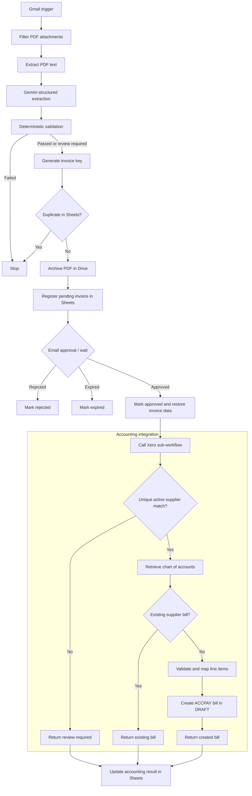

# AI-Powered Supplier Invoice Processing

An accounts payable automation built with n8n, Google Gemini and Xero. It converts emailed PDF supplier invoices into structured records and, only after human approval, creates draft bills in a test accounting organisation.

**Status:** Functional, end-to-end tested portfolio prototype (November 2026). Not a production accounting service.

## Business problem

Manual invoice capture creates repetitive data entry, inconsistent validation and duplicate-payment risk. This project demonstrates a controlled document-to-accounting pipeline that preserves original documents, validates extracted information and separates approval from accounting writes.

## Architecture

## Core capabilities

| Capability | Implementation |
| --- | --- |
| Document intake | Gmail label polling, PDF attachment filtering and native PDF text extraction |
| AI extraction | Gemini via n8n Information Extractor and a structured JSON schema; no invented missing fields |
| Validation | JavaScript checks for document type, required fields, dates, totals, payment-term discrepancies and line arithmetic |
| Duplicate checks | Normalised supplier/customer/invoice key in Sheets; invoice number and contact lookup in Xero |
| Document retention | Archive original PDFs in Google Drive before approval |
| Human-in-the-loop | Gmail Send and Wait for Response; approval, rejection and expiry branches |
| Accounting integration | OAuth2 REST calls to Xero Contacts, Accounts and Invoices; dynamic line items; draft-only ACCPAY creation |
| Traceability | Invoice key, file reference, approval timestamps, accounting status and Xero invoice ID in Sheets |

The model extracts information; deterministic code validates and maps it. The model does not approve invoices, choose arbitrary accounting codes or initiate payments.

## Repository contents

- [intake.json](intake.json) — 24-node parent workflow.
- [xero-integration.json](xero-integration.json) — 13-node callable accounting workflow.
- [invoice-register-headers.csv](invoice-register-headers.csv) — header row for the tracking sheet.

## Setup

Developed using self-hosted n8n 2.36.9 (Docker), JavaScript Code nodes, Gmail, Google Sheets, Google Drive, Gemini and Xero Accounting API.

1. Import both JSON files into n8n. The exports are inactive and contain no credential bindings or pinned execution data.
2. Configure Gmail OAuth2, Google Sheets OAuth2, Google Drive OAuth2, a Gemini API credential and Xero OAuth2 authorization-code credentials. Enable the necessary Google APIs. For Xero, the tested scope set was `offline_access accounting.contacts.read accounting.settings.read accounting.invoices`; verify scope availability for your application.
3. Create a Gmail label for test invoices and select it in Incoming Invoice (replace `YOUR_GMAIL_LABEL_ID`).
4. Create a Google spreadsheet with a tab named `Sheet1`, paste the CSV headers into row 1, and select the spreadsheet and tab in all Sheets nodes. Refresh column mappings where required. Replace `YOUR_SPREADSHEET_ID`.
5. Create a private Drive folder and select it in Archive Invoice PDF (replace `YOUR_DRIVE_FOLDER_ID`). Ensure authorised reviewers can open archived documents.
6. Replace `approver@example.invalid` in Request Invoice Approval with your internal test reviewer. Verify the approval waiting period and that the callback URL is reachable by the reviewer.
7. Connect Xero OAuth2 credentials to all HTTP Request nodes. Use a dedicated test organisation only. Retrieve its tenant ID from the Connections endpoint and replace `YOUR_XERO_TEST_TENANT_ID` in every accounting request. Do not select a production tenant.
8. Create an active test supplier whose name exactly matches the PDF supplier. Verify that expense account `412` is active and appropriate for the test; change the fixed account code if necessary. Use only test invoices with zero or unspecified VAT.
9. In Send to Xero, select the imported accounting workflow by its actual ID (replace `YOUR_XERO_SUBWORKFLOW_ID`). Keep the trigger set to Accept all data and wait for completion enabled.
10. Verify both workflows and publish the configured versions. Email a unique synthetic invoice, apply the Gmail label, verify the pending state, then approve it. Confirm the draft bill and the accounting result in the register.

## Demonstrated tests

The original configured workflows were tested against an isolated Xero organisation. The public exports have been sanitised and have not been independently re-executed after sanitisation.

| Scenario | Observed outcome |
| --- | --- |
| Fresh PDF invoice | Extracted, validated, archived and registered |
| Awaiting approval | Parent execution paused; accounting branch not executed |
| Approved invoice | Sub-workflow invoked automatically and draft bill created |
| Rejected / expired approval | Separate status-update branches tested |
| Existing Xero bill | Duplicate creation blocked; existing invoice ID returned |
| Unknown or differently named supplier | Review-required accounting result; no draft created |
| Multiple line items | Dynamic quantities and prices mapped successfully in an isolated accounting test |

One final automated test created a ZAR 1,500 draft bill after email approval, with the expected dates and supplier. No payment was initiated. Final spreadsheet accounting-field verification was not separately evidenced in the test screenshots.

## Limitations and production hardening

- Single invoice per execution is the tested path; several nodes use `.first()`. Multi-attachment processing needs item-safe mapping and tests.
- Exact case-insensitive supplier names only; verified aliases, stable supplier identifiers, customer-to-tenant validation and contact pagination remain future work.
- Expense account 412 and no-tax treatment are fixed demonstration settings. Nonzero VAT is blocked; missing VAT is not evidence of legal tax treatment. Finance must own account and tax mappings.
- Duplicate lookups are not atomic or concurrency-safe; add persistent idempotency, unique constraints, retries and recovery for partial writes.
- Failed validation and duplicate intake terminate without dedicated notification/recovery branches. API errors and unsupported tax cases can fail execution rather than return a structured exception.
- Email approval is a prototype control; production requires authenticated reviewers, access control, secure HTTPS callbacks, audit logging and retention policies.
- Gemini receives document text; review privacy, consent, data processing and access requirements before handling real invoices.
- PDF extraction requires readable text; scanned documents need OCR. No payment initiation, reconciliation or Xero PDF attachment upload is implemented.

## Skills demonstrated

Workflow orchestration, API integration, OAuth2, JSON schema design, prompt constraints, JavaScript validation, conditional routing, human-in-the-loop approval, modular sub-workflows, document archiving, duplicate checks and end-to-end debugging.

## Security

Never publish raw workflow exports, pinned emails, customer invoices, credentials, tokens, account identifiers or approval URLs. This repository contains inactive templates with placeholder configuration. Test exclusively with synthetic data and non-production accounts.
